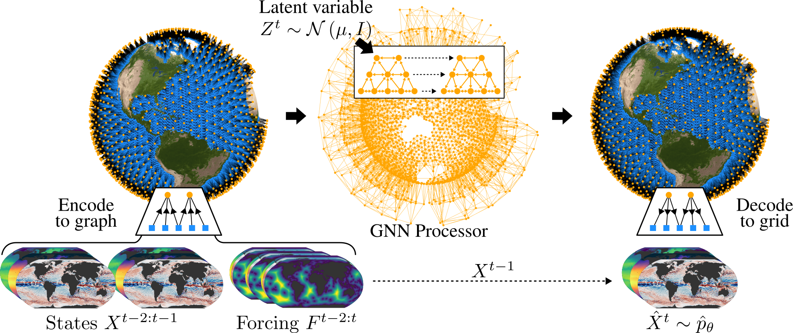
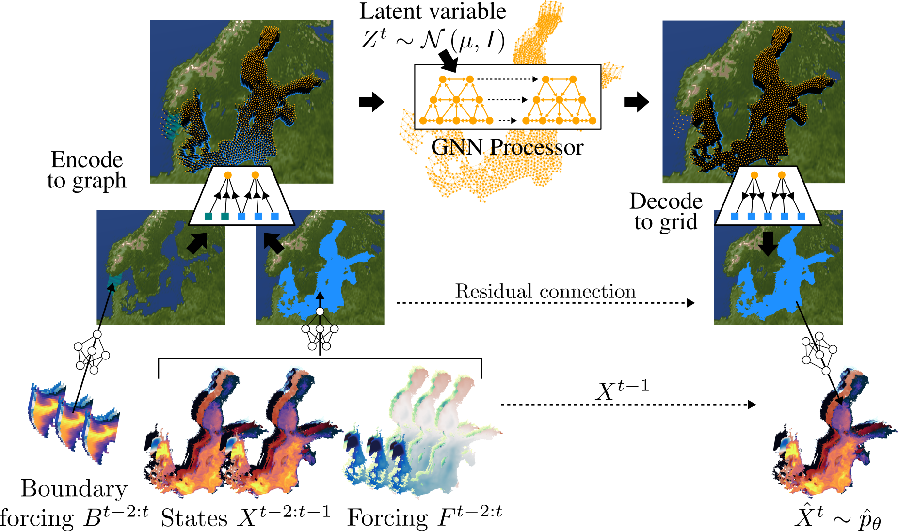

[](https://arxiv.org/abs/2605.15470)
[](https://github.com/deinal/njord/actions/workflows/pre-commit.yml)
[](https://github.com/deinal/njord/actions/workflows/install-and-test.yml)

# Njord

A probabilistic graph neural network for ensemble ocean forecasting, for both **global** and **regional** domains.

Njord combines a deep latent-variable model with hierarchical GNNs so that each forecast step is sampled in a single forward pass. The same framework is used globally at 0.25° (Njord) and regionally for the Baltic Sea at 2 km (Njord-Baltic).

This is the code for the paper [*Njord: A Probabilistic Graph Neural Network for Ensemble Ocean Forecasting*](https://arxiv.org/html/2605.15470v2).

The implementation is based on [mllam/neural-lam](https://github.com/mllam/neural-lam), adapted to ocean grids. Training-ready datasets are built with [mllam-data-prep](https://github.com/mllam/mllam-data-prep). The Python package is still imported as `neural_lam`.

<p align="middle">
    
</p>
<p align="middle">
    <em>One-step prediction in Njord. Two previous ocean states and atmospheric forcing are encoded onto a hierarchical mesh over sea points only. A latent variable <code>Z<sup>t</sup></code> is injected in the GNN processor; the decoder maps back to the grid and adds a residual to <code>X<sup>t−1</sup></code>, producing a sample from the one-step forecast distribution.</em>
</p>

Ocean dynamics are chaotic, but existing machine-learning ocean models are typically deterministic. Njord produces ensembles of the depth-resolved ocean state, including sea ice, and (in the regional setting) conditions on boundary data from an independent global ocean model.

The code uses [PyTorch](https://pytorch.org/), [PyTorch Lightning](https://lightning.ai/pytorch-lightning), [PyG](https://pyg.org/), and optional logging through [Weights &amp; Biases](https://wandb.ai/) or [MLflow](https://mlflow.org/).

## Njord-Baltic

<p align="middle">
    
</p>
<p align="middle">
    <em>One-step prediction in Njord-Baltic. The same latent-variable GNN is used on a Baltic cluster mesh, with additional lateral boundary forcing <code>B<sup>t−2:t</sup></code> from a global ocean model and atmospheric forcing <code>F<sup>t−2:t</sup></code>.</em>
</p>

## Differences to LAM for weather

Neural-LAM is a weather limited-area / global GNN codebase. Njord reuses that stack (encode–process–decode GNNs, Graph-EFM, mllam-data-prep datastores) but changes the parts that matter for the ocean:

* **Land / bathymetry masking.** The GNN runs only on sea grid points. Per-variable masks (surface and depth) drop land and dry bathymetry from the loss and from graph construction.
* **State variables.** Depth-resolved `thetao`, `so`, `uo`, `vo`, plus surface `zos`/`sla`, sea-ice concentration `siconc` and thickness `sithick`.
* **Static features.** Bathymetry `deptho`, mean dynamic topography `mdt`, and distance to coast `coast_dist` (plus projected `x_coord`/`y_coord` regionally, or spherical harmonics globally). Coast distance tells the model where the sea surface ends, since mesh nodes are not placed on land.
* **Sea ice constraints.** Output clamping keeps `siconc ∈ [0, 1]` and `sithick ≥ 0`. An optional **density channel** (Aurora inspired missing-data handling) zeros ice fields in ice-free cells during rollout so small residuals do not accumulate.
* **Cluster meshes.** Spherical (global) or Euclidean (regional) K-means over sea points, then Delaunay edges with land-crossing filtering — better coverage of bays and straits than a masked icosahedral / quadrilateral mesh.
* **Extra datastores.** Regional runs add atmosphere and lateral-boundary MDP datasets, plus separate **statistics** datastores for normalisation when the training fields are forecasts rather than the reanalysis used to compute mean/std.

# Modularity
The Neural-LAM code is designed to modularize the different components involved in training and evaluating neural weather prediction models.
Models, graphs and data are stored separately and it should be possible to swap out individual components.
Still, some restrictions are inevitable:

* The graph used has to be compatible with what the model expects. E.g. a hierarchical model requires a hierarchical graph.
* The graph and data are specific to the limited area under consideration. This is of course true for the data, but also the graph should be created with the exact geometry of the area in mind.

<p align="middle">
  
</p>

# Installation

Python **3.9–3.12** (`requires-python = ">=3.9,<3.13"`).

Install with `pdm` (recommended) or `pip`. Because `torch` ships CUDA- and CPU-specific wheels, install the torch variant you want before the rest of the project if you do not want the default GPU build.

## Using `pdm`

1. Clone this repository and navigate to the root directory.
2. Install `pdm` if you don't have it installed on your system (either with `pip install pdm` or [following the install instructions](https://pdm-project.org/latest/#installation)).
> If you are happy using the latest version of `torch` with GPU support (expecting the latest version of CUDA is installed on your system) you can skip to step 5.
3. Create a virtual environment for pdm to use with `pdm venv create --with-pip`.
4. Install a specific version of `torch` with `pdm run python -m pip install torch --index-url https://download.pytorch.org/whl/cpu` for a CPU-only version or `pdm run python -m pip install torch --index-url https://download.pytorch.org/whl/cu111` for CUDA 11.1 support (you can find the correct URL for the variant you want on [PyTorch webpage](https://pytorch.org/get-started/locally/)).
5. Install the dependencies with `pdm install` (by default this in include the). If you will be developing `neural-lam` we recommend to install the development dependencies with `pdm install --group dev`. By default `pdm` installs the `neural-lam` package in editable mode, so you can make changes to the code and see the effects immediately.

## Using `pip`

1. Clone this repository and navigate to the root directory.
> If you are happy using the latest version of `torch` with GPU support (expecting the latest version of CUDA is installed on your system) you can skip to step 3.
2. Install a specific version of `torch` with `python -m pip install torch --index-url https://download.pytorch.org/whl/cpu` for a CPU-only version or `python -m pip install torch --index-url https://download.pytorch.org/whl/cu111` for CUDA 11.1 support (you can find the correct URL for the variant you want on [PyTorch webpage](https://pytorch.org/get-started/locally/)).
3. Install the dependencies with `python -m pip install .`. If you will be developing `neural-lam` we recommend to install in editable mode and install the development dependencies with `python -m pip install -e ".[dev]"` so you can make changes to the code and see the effects immediately.

# Data

## Sources

| Role | Typical products | Where to get them |
| --- | --- | --- |
| Global ocean reanalysis / analysis | GLORYS12, GLO12 | [Copernicus Marine Data Store](https://data.marine.copernicus.eu/) |
| Regional Baltic reanalysis / analysis | Baltic Sea Physics Reanalysis and operational analysis | Copernicus Marine |
| Evaluation vs. operational forecasts and observations | OceanBench tracks | [OceanBench](https://github.com/mercator-ocean/oceanbench) |
| Atmospheric forcing (training) | ERA5 | Copernicus Climate / ECMWF |
| Atmospheric forcing (forecast evaluation) | IFS / AIFS | [ECMWF MARS](https://www.ecmwf.int/en/forecasts/datasets), [ECMWF Open Data](https://www.ecmwf.int/en/forecasts/datasets/open-data), [Dynamical](https://dynamical.org/catalog/), [Earth2Studio](https://github.com/NVIDIA/earth2studio) |
| Regional lateral boundaries at evaluation | GLO12 (or similar) forecasts | OceanBench / Copernicus Marine |

Licensing is set by those providers (Copernicus Marine, ECMWF, OceanBench EUPL-1.2, etc.). See the paper appendix for the product DOIs used in the experiments.

Trained weights from the paper are available on request.

## mllam-data-prep

All ocean, atmosphere, and boundary fields used here go through [mllam-data-prep](https://github.com/mllam/mllam-data-prep) into training-ready zarr (stacked variables, flattened `grid_index`, train/val/test splits, normalisation statistics).

```bash
python -m mllam_data_prep --config data/baltic_sea_mdp_config.yaml
```

The resulting zarr path is derived from the MDP config name (`baltic_sea_mdp_config.yaml` → `baltic_sea_mdp_config.zarr`). Example MDP and Njord YAML files live in [`data/`](data/). **Paths inside those files are machine-specific**; copy and edit them to your stores.

### Masks and static fields

MDP configs declare a `mask` category alongside `state`, `forcing`, and `static`:

* **Surface mask** sea vs land.
* **Depth mask** per-variable bathymetry.
* **Static** `deptho`, `mdt`, `coast_dist`, and coordinates.

Loss, metrics, and graph construction all use these masks.

### Njord YAML: several datastores

A Njord config (for example [`data/baltic_sea_forecasts.yaml`](data/baltic_sea_forecasts.yaml)) can name more than one MDP dataset:

| Key | Role |
| --- | --- |
| `datastore` | Predicted ocean state (and calendar forcing derived on that grid) |
| `datastore_boundary` | Lateral ocean boundary forcing (regional only) |
| `datastore_atmosphere` | Surface atmospheric forcing |
| `statistics_datastore` | Mean/std (and diff stats) for **normalising the ocean state** |
| `statistics_datastore_boundary` / `_atmosphere` | Same idea for boundary and atmosphere |

`statistics_*` exist so you can **train or evaluate on forecast-style tensors** (`init_time` × `lead_time`) while still normalising with statistics computed on a long reanalysis / analysis record. Forecast zarrs are too short and too correlated to estimate robust mean/std.

Two Baltic layouts in this repo:

* **[`data/baltic_sea_finetune.yaml`](data/baltic_sea_finetune.yaml)** reanalysis/analysis along a `time` axis. The same MDP configs are used for data and for statistics (no `statistics_*` keys needed).
* **[`data/baltic_sea_forecasts.yaml`](data/baltic_sea_forecasts.yaml)** operational-style forecasts (`init_time`, `lead_time`) for ocean, GLO12-style boundaries, and AIFS atmosphere, with `statistics_*` pointing at the finetune MDP configs.

Training options in the same YAML:

* `state_feature_weighting` per-variable loss weights (surface vs depth).
* `output_clamping` physical bounds for sea ice.
* `density_channel` binary ice-presence channel tied to `siconc` / `sithick`.

```yaml
datastore:
  kind: mdp
  config_path: baltic_sea_gt_forecasts_mdp_config.yaml
datastore_boundary:
  kind: mdp
  config_path: baltic_boundary_forecasts_mdp_config.yaml
datastore_atmosphere:
  kind: mdp
  config_path: baltic_aifs_forecasts_mdp_config.yaml
statistics_datastore:
  kind: mdp
  config_path: baltic_sea_ft_mdp_config.yaml
# ... statistics for boundary and atmosphere ...
training:
  output_clamping:
    upper: { siconc: 1.0 }
    lower: { siconc: 0.0, sithick: 0.0 }
  density_channel:
    reference_var: siconc
    associated_vars: [siconc, sithick]
```

The parent directory of the Njord YAML is the run root: graphs are written under `<root>/graphs/<name>/`.

# Graph creation

Mesh files are stored under `graphs/<name>/` next to the datastore. Hierarchical graphs keep per-level lists for mesh edges and features; extra `mesh_up_*` / `mesh_down_*` files connect levels.

## Regional (Baltic) — `create_graph`

K-means cluster mesh (or hierarchical / multiscale) on the regional Lambert grid, including optional boundary and atmosphere nodes:

```bash
python -m neural_lam.create_graph \
    --config_path data/baltic_sea.yaml \
    --name cluster \
    --type cluster \
    --levels 3 \
    --grid_to_first_mesh_refinement 9 \
    --mesh_refinement_factor 9 \
    --plot \
    --connect_disconnected
```

`--plot` writes overview figures while the graph is built. Paper-style Baltic cluster graphs use refinement 9 (for comparison to a 3×3 quadrilateral coarsening). See `python -m neural_lam.create_graph --help`.

## Global — `create_global_graph`

Spherical K-means over sea points, spherical Delaunay edges, land-crossing filter. Types: `cluster` (paper default), `hierarchical` / `multiscale` icosahedral.

```bash
python -m neural_lam.create_global_graph \
    --config_path data/global_ocean.yaml \
    --name global_cluster_1_4_deg_20_refinement_3_levels \
    --type cluster \
    --levels 3 \
    --grid_to_first_mesh_refinement 20 \
    --mesh_refinement_factor 3 \
    --plot \
    --connect_disconnected
```

## Auxiliary graph — `create_auxiliary_graph`

Reuse a **mesh trained at one resolution** and rebuild only **grid–mesh (g2m / m2g)** edges for a new grid. That is how global 1° pretraining is transferred to 0.25° finetuning without changing the mesh processor:

```bash
python -m neural_lam.create_auxiliary_graph \
    --config_path data/analysis_ocean.yaml \
    --name global_cluster_analysis \
    --name_original global_cluster_1_4_deg_20_refinement_3_levels \
    --plot \
    --connect_disconnected
```

## Plotting graphs

```bash
# Regional 3D / interactive plot
python -m neural_lam.plot_graph_3d \
    --config_path data/baltic_sea.yaml \
    --graph_name cluster \
    --save baltic_graph.html

# Global
python -m neural_lam.plot_global_graph_3d \
    --config_path data/global_ocean.yaml \
    --graph_name global_cluster_1_4_deg_20_refinement_4_levels \
    --save global_graph.html
```

# Training

```bash
python -m neural_lam.train_model --config_path data/baltic_sea.yaml --help
```

Checkpoints go to `saved_models/`. Paper models:

| `--model` | Paper name | Notes |
| --- | --- | --- |
| `graph_efm` | **Njord** | Latent-variable ensemble model (ELBO + CRPS) |
| `graph_fm` | **SeaCast** (deterministic baseline) | Hierarchical GNN, MSE |
| `graphcast` | GraphCast-style | Non-hierarchical encode–process–decode |

Useful flags: `--graph` (directory name under `graphs/`), `--processor_layers`, `--hidden_dim`, `--ar_steps_train` / `--ar_steps_eval`, `--kl_beta`, `--crps_weight`, `--load` (checkpoint), `--eval val` or `--eval test`.

## Training curriculum

Njord is not trained in one job. Typical **Graph-EFM** stages (see also `graph_efm_1.sh`–`graph_efm_4.sh`):

1. **Autoencoder** (`--kl_beta 0 --crps_weight 0 --ar_steps_train 1`) — learn to encode/decode; prior unused.
2. **One-step ELBO** (`--kl_beta 0.1`) — train prior and variational posterior together.
3. **Unrolled ELBO** (`--ar_steps_train 2`) — temporal consistency.
4. **CRPS finetune** (`--crps_weight` large, still unrolled) — ensemble spread/calibration.
5. **Analysis finetune** — same model, switch YAML to analysis (and, globally, to 0.25° via an auxiliary graph). Use `statistics_*` when the tensors are forecasts.

**Global** extra: pretrain at 1°, then finetune at 0.25° (auxiliary graph keeps the mesh). **Regional:** reanalysis curriculum, then a shorter analysis finetune (`baltic_sea_finetune.yaml` vs forecast YAML).

SeaCast uses weighted MSE, then a short autoregressive unroll, then analysis finetune (`seacast_pretrain.sh`, `seacast_finetune.sh`).

## Evaluation

```bash
python -m neural_lam.train_model \
    --config_path data/baltic_sea_forecasts.yaml \
    --model graph_efm \
    --graph cluster \
    --eval test \
    --load saved_models/<run>/last.ckpt \
    --ar_steps_eval 10 \
    --n_example_pred 1
```

Prefer a **single GPU** for `--eval`: Lightning’s distributed sampler can duplicate samples and bias metrics.

# Logging

**Weights &amp; Biases** is our default logger (`wandb login` / `wandb off`).

# Multi-GPU / HPC

PyTorch Lightning **DDP**. On Slurm set `--num_nodes` to `$SLURM_JOB_NUM_NODES`. Without Slurm, `--devices 0 1` selects GPUs. Example job scripts are under `training_scripts/` (they still use site-specific modules and paths).

# Repository layout

```
neural_lam/           # package (models, datastore, graph construction, training)
data/                 # example Njord + MDP YAML (Baltic)
training_scripts/     # staged train commands
eval_scripts/         # evaluation commands
graph_scripts/        # graph + auxiliary-graph jobs
figures/              # README diagrams
tests/                # pytest
```

# Citation

If you use this code, please cite **Njord**, and **SeaCast** if you use the deterministic regional/global baseline.

#### Njord

```bibtex
@article{holmberg2026njord,
  title={Njord: A Probabilistic Graph Neural Network for Ensemble Ocean Forecasting},
  author={Holmberg, Daniel and Oskarsson, Joel and Wikingsson, Erik and Lindsten, Fredrik and Roos, Teemu},
  journal={arXiv preprint arXiv:2605.15470},
  year={2026}
}
```

#### SeaCast

```bibtex
@inproceedings{holmberg2024regional,
    title={Regional Ocean Forecasting with Hierarchical Graph Neural Networks},
    author={Holmberg, Daniel and Clementi, Emanuela and Roos, Teemu},
    booktitle={NeurIPS 2024 Workshop on Tackling Climate Change with Machine Learning},
    year={2024}
}
```

```bibtex
@article{holmberg2025accurate,
  title={Accurate Mediterranean Sea forecasting via graph-based deep learning},
  author={Holmberg, Daniel and Clementi, Emanuela and Epicoco, Italo and Roos, Teemu},
  journal={Scientific Reports},
  volume={15},
  number={1},
  pages={45051},
  year={2025}
}
```

The architecture builds on Neural-LAM / Graph-EFM ([Oskarsson et al., 2024](https://arxiv.org/abs/2406.04759); [github.com/mllam/neural-lam](https://github.com/mllam/neural-lam)). Cite that work if you rely on the weather GNN / latent-variable design rather than the ocean-specific changes.

# Contact

Questions about Njord: [daniel.holmberg@helsinki.fi](mailto:daniel.holmberg@helsinki.fi).
